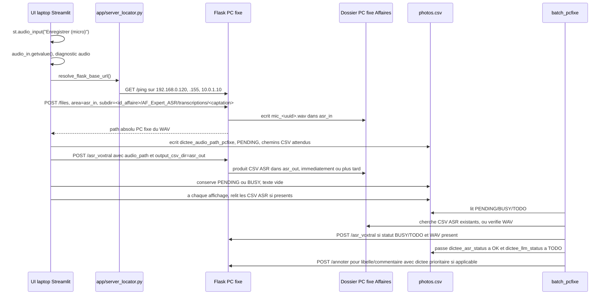

# Audit - flux des dictees ASR

Date audit : 2026-07-07

Perimetre lu :

- `app/annotation_interface_gpt.py`
- `app/local_llm_client.py`
- `app/server_locator.py`
- `batch_pcfixe/batch_all_photos_pcfixe.py`
- `batch_pcfixe/local_llm_client.py`
- `config/config.json`
- fichiers de schema/initialisation de colonnes : `app/main.py`, `app/selection_fichiers_interface.py`

Contraintes respectees :

- aucune modification du serveur Flask ;
- aucune modification de route Flask ;
- aucune modification de logique ASR ;
- aucun commit.

Note importante : l'audit porte sur l'etat courant du workspace. `app/annotation_interface_gpt.py` et `batch_pcfixe/batch_all_photos_pcfixe.py` contiennent deja des modifications non commitees.

## Schema du flux actuel

## Flux UI detaille

### Creation du WAV

Fichier : `app/annotation_interface_gpt.py`

- Le composant d'entree est `st.audio_input("Enregistrer (micro)", key=f"mic_{i}")`.
- Le WAV est recupere par `audio_in.getvalue()`.
- Le nom serveur est genere sous la forme `mic_<uuid>.wav`.
- Avant upload, l'audio est analyse par `_analyze_audio_bytes()`. Si le signal est silencieux, l'UI ecrit `dictee_asr_status = ERR_SILENT_AUDIO`.

### Calcul des chemins PC fixe

Fonctions :

- `_require_server_project_context(infos)` recupere `project_id` et le bloc `infos["pcfixe"]`.
- `extract_affaire_captation(pcfixe)` extrait `id_affaire`, `id_captation` et `base_transcriptions_dir` depuis des chemins PC fixe.
- `compute_asr_subdir_from_pcfixe(pcfixe)` calcule le sous-dossier relatif envoye a Flask :
  `id_affaire/AF_Expert_ASR/transcriptions/id_captation`
- `compute_dictee_target_dir(pcfixe)` calcule le dossier attendu du WAV :
  `<base_transcriptions_dir>/asr_in`
- `compute_asr_out_dir_from_pcfixe(pcfixe)` calcule le dossier de sortie ASR :
  `<base_transcriptions_dir>/asr_out`

Le flux suppose donc que le bloc `pcfixe` d'`infos_projet.json` contient des chemins absolus PC fixe vers `AF_Expert_ASR/transcriptions/<id_captation>`.

### Upload du WAV vers le PC fixe

Fichiers :

- `app/annotation_interface_gpt.py`
- `app/local_llm_client.py`

Route Flask :

- `POST /files`
- commentaire code : alias possible de `/upload_file`, mais l'appel actuel utilise `/files`.

Appel :

- `LocalLLMClient.upload_file_bytes(file_bytes, filename, project_id, area="asr_in", overwrite=True, subdir=subdir_in)`
- `subdir_in` vaut le sous-dossier relatif `id_affaire/AF_Expert_ASR/transcriptions/id_captation`.
- Le commentaire indique que `area="asr_in"` pointe deja vers le dossier `asr_in`, donc le sous-dossier ne doit pas rajouter `asr_in`.

Payload/form-data :

- `file`: contenu WAV ;
- `project_id`: identifiant serveur ;
- `area`: `asr_in` ;
- `filename`: `mic_<uuid>.wav` ;
- `overwrite`: `true` ;
- `subdir`: chemin relatif de la captation.

Retour attendu :

- JSON avec `ok` et `path`.
- `path` est le chemin absolu PC fixe du WAV ; il est inscrit dans `photos.csv` en `dictee_audio_path_pcfixe`.

### Declenchement ASR par l'UI

Fichiers :

- `app/annotation_interface_gpt.py`
- `app/local_llm_client.py`

Route Flask :

- `POST /asr_voxtral`

Appel :

- `LocalLLMClient.asr_voxtral(audio_path_server, ..., output_csv_dir=out_dir_abs, export_raw_csv=True, export_photo_csv=True, request_timeout=8, allow_timeout_success=True)`

Payload principal :

- `audio_path`: chemin PC fixe renvoye par `/files` ;
- `output_csv_dir`: `<base_transcriptions_dir>/asr_out` ;
- `lang`: `fr` ;
- `timestamps`: `True` ;
- `auto_chunk`, `chunk`, `stride`, `cpu`, `no4bit`, `batch_size`, `model_key`, `client_tag` depuis `config.json` / `config_llm.json` ;
- exports CSV bruts et photo actives.

Comportement actuel :

- l'UI ecrit une premiere fois `PENDING` juste apres l'upload ;
- elle tente ensuite `/asr_voxtral` avec un timeout court de 8 secondes ;
- si l'appel est long mais accepte, `allow_timeout_success=True` permet de rester en attente ;
- si le serveur renvoie un conflit de type `HTTP 409: ASR Voxtral deja en cours`, l'UI marque `dictee_asr_status = BUSY` et conserve le WAV pour reprise batch ;
- sinon une erreur marque `ERR`.

Point important : meme apres l'appel `/asr_voxtral`, le code remet explicitement `dictee_asr_text = ""` et `dictee_asr_status = "PENDING"` dans le cas nominal local. Le texte est ensuite recupere par relecture des CSV produits cote serveur.

### Relecture ASR dans l'UI

Fonctions :

- `_dictation_csv_candidates(audio_path_server, out_dir_abs)`
- `_read_dictee_text_from_csv(csv_path)`
- `_refresh_pending_dictee(...)`
- `_refresh_all_pending_dictees(...)`

Champs lus :

- `dictee_asr_status`
- `dictee_audio_path_pcfixe`
- `dictee_asr_text`
- `dictee_asr_csv_path_pcfixe`
- `dictee_asr_photo_csv_path_pcfixe`

Regle :

- `_is_dictee_pending()` considere `PENDING`, `TODO` et `BUSY` comme des statuts a rafraichir.
- Si un CSV ASR existe et contient une colonne `text`, le texte est concatene, puis l'UI ecrit :
  - `dictee_asr_text = <texte relu>`
  - `dictee_asr_status = OK`
  - `dictee_asr_ts = <now>`
  - chemins CSV si connus.
- Si des CSV existent mais sans texte exploitable, l'UI marque `ERR`.

## Flux batch detaille

Fichier : `batch_pcfixe/batch_all_photos_pcfixe.py`

Le batch semble concu prioritairement pour tourner sur PC fixe :

- le nom de dossier est `batch_pcfixe` ;
- les chemins image UNC `\\192.168.0.155\Affaires` sont convertis en `C:\Affaires` dans `resolve_img_path()` ;
- les chemins audio sont testes avec `Path(audio_path).exists()`, ce qui suppose un chemin local lisible par la machine qui execute le batch ;
- le client batch local `batch_pcfixe/local_llm_client.py` garde un fallback `http://127.0.0.1:5050`.

### Colonnes garanties par le batch

Dans `UI_DEFAULTS`, le batch ajoute si besoin :

- `annotation_validee`
- `dictee_audio_path_pcfixe`
- `dictee_asr_status`
- `dictee_asr_text`
- `dictee_asr_error`
- `dictee_asr_ts`
- `dictee_asr_csv_path_pcfixe`
- `dictee_asr_photo_csv_path_pcfixe`
- `dictee_llm_status`
- `dictee_llm_asr_ts`
- `dictee_llm_error`
- `dictee_llm_ts`

### Reprise des ASR differees

Fonction : `process_deferred_dictees(...)`

Ordre actuel :

1. Le batch selectionne les lignes `selected_idx` selon les criteres generaux de traitement photo/VLM/LLM.
2. Apres la passe VLM et `purge_vlm()`, il lance la passe `PASS 1bis - ASR des dictees differees`.
3. Il appelle `process_deferred_dictees()` uniquement si `not is_dry and base_url`.

Regles par statut :

- Si `annotation_validee` est vraie :
  - le batch ne relance pas l'ASR ;
  - si une dictee OK existe avec `dictee_llm_status = TODO` ou un `dictee_asr_ts` nouveau, il met `dictee_llm_status = SKIP_VALIDATED`.
- Si `dictee_asr_status = PENDING` et `dictee_asr_text` vide :
  - le batch cherche d'abord un CSV ASR existant via `_read_deferred_asr_text()`;
  - si texte trouve, il passe `dictee_asr_status = OK`, remplit `dictee_asr_text`, vide `dictee_asr_error`, met `dictee_llm_status = TODO`.
  - il ne relance pas `/asr_voxtral` dans cette branche.
- Si le statut n'est pas `BUSY` ou `TODO`, ou si pas de WAV, ou si un texte ASR est deja present :
  - pas d'action ASR.
- Si statut `BUSY` ou `TODO`, WAV present, texte vide :
  - verifie `Path(audio_path).exists()`;
  - appelle `/asr_voxtral` via `_post_asr_voxtral_deferred()`;
  - si texte recu ou relu depuis CSV, passe `OK` et `dictee_llm_status = TODO`;
  - si `HTTP 409`, conserve `BUSY`;
  - sinon marque `ERR`.

Conclusion d'arbitrage ASR UI vs batch :

- l'UI declenche immediatement l'ASR apres upload, puis laisse `PENDING`/`BUSY`;
- le batch reprend seulement certains cas :
  - `PENDING` : uniquement par relecture de CSV existants, sans relance ASR ;
  - `BUSY` ou `TODO` : relance `/asr_voxtral` si le WAV existe ;
  - `ERR` : pas de reprise automatique ;
  - `OK` : pas d'ASR, mais possible retraitement LLM si `dictee_llm_status` n'est pas OK ou si l'ASR est plus recente que `dictee_llm_asr_ts`.

Point fragile : l'UI marque le cas nominal local en `PENDING`. Si `/asr_voxtral` n'a pas effectivement lance un job durable, le batch ne relancera pas l'ASR tant que le statut reste `PENDING`.

### Usage de la dictee dans le LLM batch

Fonctions :

- `needs_dictee_llm_retry(row_ui)`
- `generate_with_retry(...)`
- `LocalLLMClient.generate(...)` dans `batch_pcfixe/local_llm_client.py`

Regles :

- `needs_dictee_llm_retry()` retourne vrai si :
  - `annotation_validee` est faux ;
  - `dictee_asr_status == OK` ;
  - `dictee_asr_text` non vide ;
  - `dictee_llm_status != OK` ou `dictee_llm_asr_ts != dictee_asr_ts`.
- En passe LLM, si `dictee_ok`, le batch peut utiliser la dictee comme seed de libelle si pas de transcription autour de la photo.
- Si `dictee_retry_target`, le prompt contient un bloc :
  `Correction / complement de l'expert a appliquer prioritairement`.
- Les appels `/annoter` portent `prefer_dictee=True` quand une dictee OK existe.
- Apres LLM, le batch ecrit :
  - `dictee_llm_ts`
  - `dictee_llm_asr_ts`
  - `dictee_llm_status = OK` ou `ERR`
  - `dictee_llm_error`

## Routes Flask utilisees

### Upload/copier le WAV

- UI : `POST /files`
- Appelant : `app/local_llm_client.py::LocalLLMClient.upload_file_bytes`
- Base URL : `LocalLLMClient.base_url`, elle-meme issue de `app/server_locator.py` si pas forcee par config/env.

### ASR Voxtral

- UI : `POST /asr_voxtral`
- Appelant : `app/local_llm_client.py::LocalLLMClient.asr_voxtral`
- Base URL : `app/server_locator.py` via `request_with_endpoint_fallback()`.

- Batch : `POST /asr_voxtral`
- Appelant : `batch_pcfixe/batch_all_photos_pcfixe.py::_post_asr_voxtral_deferred`
- Base URL : `local_llm.base_url` lu dans `config_llm.json`.
- Le batch n'utilise pas `app/server_locator.py`.

### LLM annotation

- UI : `POST /annoter`
- Appelant principal dictée/annotation : `generer_texte_gpt()` utilise encore `requests.post(base_url + "/annoter")`, avec `base_url` resolu en amont par `_resolve_local_llm_settings()`.
- `LocalLLMClient.generate()` utilise `request_with_endpoint_fallback()`, mais les boutons UI principaux passent encore par `generer_texte_gpt()`.

- Batch : `POST /annoter`
- Appelant : `batch_pcfixe/local_llm_client.py::LocalLLMClient.generate`
- Base URL : `local_llm.base_url` lu dans `config_llm.json`, ou fallback `http://127.0.0.1:5050` si absent.

### Autres routes batch liees

- `POST /vision/purge_vlm`
- `POST /vision/describe_batch`

Ces routes ne sont pas specifiques aux dictees ASR mais conditionnent l'ordre du batch : purge VLM avant ASR differee puis LLM.

## Champs CSV dictée

| Champ | Ecrit par UI | Lu par UI | Ecrit par batch | Lu par batch | Role |
| --- | --- | --- | --- | --- | --- |
| `dictee_audio_path_pcfixe` | Oui, chemin `path` renvoye par `/files` ; vide en backend OpenAI | Oui | Oui en cas erreur/reprise | Oui | Chemin absolu PC fixe du WAV |
| `dictee_asr_status` | `PENDING`, `BUSY`, `ERR`, `ERR_SILENT_AUDIO`, `OK` en OpenAI | Oui | `OK`, `BUSY`, `ERR`, `SKIP_VALIDATED` via LLM | Oui | Etat ASR/reprise |
| `dictee_asr_text` | Texte OpenAI, vide en local au lancement | Oui | Texte relu ou recu ASR | Oui | Texte de dictee utilisable dans prompts |
| `dictee_asr_error` | Vide, message erreur, `HTTP 409...` | Affichage indirect | Vide ou erreur | Oui | Diagnostic |
| `dictee_asr_ts` | Timestamp a l'upload/lancement/erreur | Oui | Timestamp si reprise | Oui | Arbitrage LLM |
| `dictee_asr_csv_path_pcfixe` | Chemin attendu vers CSV brut | Oui | Complete si absent | Oui | Relecture texte ASR |
| `dictee_asr_photo_csv_path_pcfixe` | Chemin attendu vers CSV photo | Oui | Lu comme candidat, peu ecrit sauf via CSV existant | Oui | Relecture alternative |
| `dictee_llm_status` | Non dans le flux UI observe | Non principal | `TODO`, `OK`, `ERR`, `SKIP_VALIDATED` | Oui | Savoir si la dictee a ete integree aux propositions LLM |
| `dictee_llm_asr_ts` | Non | Non principal | Timestamp ASR traite par LLM | Oui | Eviter ou forcer retraitement |
| `dictee_llm_error` | Non | Non principal | Erreur LLM associee | Oui | Diagnostic |
| `dictee_llm_ts` | Non | Non principal | Timestamp LLM | Oui | Suivi |
| `dictee_audio_sha256` | Backend OpenAI uniquement | Non principal | Schema seulement | Non principal | Trace audio sans upload |
| `dictee_audio_size` | Backend OpenAI uniquement | Non principal | Schema seulement | Non principal | Trace audio sans upload |

Colonnes initialisees ailleurs :

- `app/selection_fichiers_interface.py` initialise notamment `dictee_asr_text`, `dictee_asr_status`, `dictee_asr_ts`, `dictee_audio_path_pcfixe`, `dictee_asr_csv_path_pcfixe`, `dictee_asr_photo_csv_path_pcfixe`, `dictee_audio_sha256`, `dictee_audio_size`.
- `app/main.py` contient une liste `DICTEE_COLS` plus ancienne, limitee a `dictee_audio_path_pcfixe`, `dictee_asr_text`, `dictee_asr_status`, `dictee_asr_ts`, `dictee_audio_sha256`, `dictee_audio_size`.
- Le batch complete le schema avec les champs `dictee_asr_error` et `dictee_llm_*`.

## Chemins manipules

### Laptop/UI

- Capture en memoire via `st.audio_input()`.
- Pas de fichier WAV local persistant observe avant upload.
- `photos.csv` est reecrit par l'UI avec des chemins PC fixe.

### PC fixe

Chemins deduits depuis `infos["pcfixe"]` :

- Transcriptions : `<Affaires>/<id_affaire>/AF_Expert_ASR/transcriptions/<id_captation>`
- WAV dictée : `<...>/asr_in/mic_<uuid>.wav`
- CSV ASR : `<...>/asr_out/mic_<uuid>(wav).csv` ou variantes candidates.

### UNC / conversion

- Le batch convertit certains chemins image `\\192.168.0.155\Affaires` vers `C:\Affaires`.
- Aucun mecanisme equivalent n'a ete vu pour `dictee_audio_path_pcfixe`; le batch utilise directement `Path(audio_path).exists()`.
- Cela renforce l'hypothese que le batch doit tourner sur le PC fixe, ou dans un environnement qui voit les chemins PC fixe tels quels.

## Usage de `server_locator.py`

### Oui, cote UI/app

- `app/annotation_interface_gpt.py` appelle `resolve_flask_base_url()` dans `_resolve_local_llm_settings()`.
- `app/local_llm_client.py` utilise `resolve_flask_base_url()` et `request_with_endpoint_fallback()` pour :
  - `/annoter`
  - `/files`
  - `/asr_voxtral`
- `config/config.json` a maintenant `local_llm.base_url = ""`, donc le resolver est sollicite par defaut.

### Non, cote batch PC fixe

- `batch_pcfixe/batch_all_photos_pcfixe.py` lit `base_url = cfg_llm["local_llm"]["base_url"]`.
- `batch_pcfixe/local_llm_client.py` a encore un fallback `http://127.0.0.1:5050`.
- `_post_asr_voxtral_deferred()` appelle directement `requests.post(base_url + "/asr_voxtral")`.
- `purge_vlm()` et les appels VLM utilisent aussi `base_url` directement.

Interpretation : c'est coherent si le batch est strictement PC fixe, mais dangereux si on le lance depuis laptop ou NAS avec une config vide.

## IPs codees en dur / loopback

Dans le flux UI dictée :

- Pas de `192.168.0.155:5050` direct dans le chemin dictée local actuel.
- `app/server_locator.py` contient les endpoints preferes, dont `192.168.0.155:5050`, mais avec ordre robuste et exclusion loopback hors PC fixe.
- `app/annotation_interface_gpt.py` contient encore des URLs `127.0.0.1:5000` pour le serveur audio local navigateur/audio, pas pour Flask PC fixe `5050`.

Dans le batch :

- `batch_pcfixe/local_llm_client.py` fallback `http://127.0.0.1:5050`.
- `batch_pcfixe/batch_all_photos_pcfixe.py` convertit `\\192.168.0.155\Affaires` vers `C:\Affaires`.
- Pas d'usage du resolver robuste cote batch.

## Points fragiles

1. `asr_dictee()` contient un chemin local legacy cassable : pour `asr_backend=local`, il appelle `asr_voxtral_from_server_path(...)`, fonction non definie dans l'etat courant du workspace. Le bouton dictée local ne semble pas utiliser ce chemin, mais la fonction reste dangereuse si reutilisee.
2. Le statut UI nominal local reste `PENDING` apres tentative `/asr_voxtral`. Le batch ne relance pas l'ASR pour `PENDING`; il ne fait que relire un CSV existant. Si le serveur n'a pas lance de traitement durable, la dictee peut rester bloquee.
3. Le statut `BUSY` est repris par batch, mais seulement si la ligne est dans `selected_idx`; cette selection depend aussi des criteres photo/VLM/LLM.
4. `dictee_asr_ts` est rempli des le passage `PENDING`, avant que le texte ASR existe. Cela peut compliquer l'arbitrage `dictee_llm_asr_ts`.
5. `app/main.py` et `app/selection_fichiers_interface.py` n'ont pas exactement la meme liste de colonnes dictée que le batch (`dictee_asr_error`, `dictee_llm_*` absents de certains schemas initiaux).
6. Le batch n'utilise pas `app/server_locator.py`, et son client local garde un fallback loopback. C'est acceptable PC fixe, risqué hors PC fixe.
7. Le batch ne normalise pas `dictee_audio_path_pcfixe` UNC vers local, contrairement aux chemins image.
8. `LocalLLMClient.asr_voxtral()` peut retourner `""` en cas de timeout autorise, puis le flux UI persiste `PENDING` et depend entierement des CSV produits par le serveur.
9. `generer_texte_gpt()` dans l'UI utilise encore `requests.post(base_url + "/annoter")` sans `request_with_endpoint_fallback()`, meme si `base_url` a ete resolu au chargement config.

## Recommandations par lots

### Lot A - Documentation et garde-fous sans changement serveur

- Documenter officiellement que `batch_pcfixe` doit tourner sur PC fixe, sauf adaptation explicite.
- Ajouter une verification de contexte au lancement batch : hostname/`ON_PCFIXE`/presence `C:\Affaires`, ou alors exiger une base URL et des chemins lisibles.
- Aligner les schemas de colonnes dictée entre `selection_fichiers_interface.py`, `main.py` et `batch_all_photos_pcfixe.py`.

### Lot B - Stabilisation du statut ASR UI/batch

- Clarifier la difference entre :
  - `PENDING_SUBMITTED` ou equivalent : job ASR envoye au serveur ;
  - `PENDING_CSV` : attente relecture CSV ;
  - `TODO` : ASR a lancer par batch ;
  - `BUSY` : serveur occupe, batch peut relancer plus tard.
- Decider si le batch doit relancer aussi les `PENDING` trop anciens sans CSV.
- Ne mettre `dictee_asr_ts` final qu'au moment ou le texte ASR est disponible, ou ajouter un champ distinct `dictee_asr_submit_ts`.

### Lot C - Endpoint resolver cote batch si le batch peut tourner hors PC fixe

- Si le batch doit pouvoir tourner depuis laptop/NAS, brancher `batch_pcfixe` sur un resolver compatible, ou importer un module commun partage.
- Supprimer le fallback implicite `127.0.0.1:5050` hors mode PC fixe explicite.
- Adapter les chemins `dictee_audio_path_pcfixe` pour UNC/NAS si execution hors PC fixe.

### Lot D - Nettoyage legacy

- Remplacer ou supprimer le chemin `asr_dictee(... asr_backend=local)` qui appelle `asr_voxtral_from_server_path()` absent.
- Faire passer `generer_texte_gpt()` par `LocalLLMClient.generate()` ou `request_with_endpoint_fallback()` pour avoir le meme fallback endpoint sur `/annoter`.
- Centraliser les calculs de chemins `asr_in` / `asr_out` pour eviter les divergences UI/batch.

## Reponses courtes aux questions

1. Le WAV est cree en memoire par `st.audio_input()` dans `app/annotation_interface_gpt.py`, puis nomme `mic_<uuid>.wav`.
2. Il est envoye au PC fixe par `POST /files` via `LocalLLMClient.upload_file_bytes()`.
3. Le chemin inscrit dans `photos.csv` est le `path` absolu PC fixe retourne par `/files`, champ `dictee_audio_path_pcfixe`.
4. Les champs dictée principaux sont `dictee_audio_path_pcfixe`, `dictee_asr_status`, `dictee_asr_text`, `dictee_asr_error`, `dictee_asr_ts`, `dictee_asr_csv_path_pcfixe`, `dictee_asr_photo_csv_path_pcfixe`, `dictee_llm_status`, `dictee_llm_asr_ts`, `dictee_llm_error`, `dictee_llm_ts`, plus `dictee_audio_sha256` et `dictee_audio_size` en backend OpenAI.
5. L'ASR est declenchee immediatement dans l'UI, puis peut etre reprise par le batch dans certains cas.
6. Arbitrage : `PENDING` relit seulement les CSV ; `BUSY`/`TODO` peuvent relancer `/asr_voxtral`; `OK` declenche seulement le besoin LLM ; `ERR` n'est pas repris automatiquement.
7. Endpoints : upload `/files`; ASR `/asr_voxtral`; LLM `/annoter`.
8. `server_locator.py` est utilise cote UI/app, mais pas cote `batch_pcfixe`.
9. Cote UI dictée, pas de fallback `127.0.0.1:5050` observe ; cote batch, oui dans `batch_pcfixe/local_llm_client.py`.
10. Le batch est manifestement concu pour PC fixe en priorite ; une execution laptop n'est pas robuste sans adaptation chemins + endpoint.
